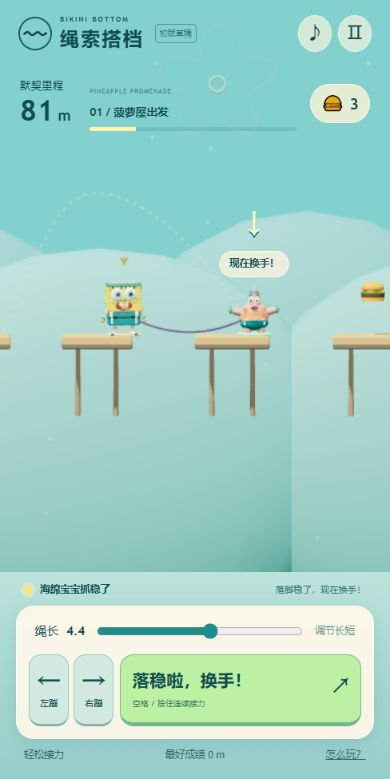

# Loopit V1 草稿与实测记录

日期：2026-11-04。作品名：比奇堡·绳索搭档。当前为未送审草稿，未执行展厅发布。

- [创作项目](https://lab.loopit.me/pgc/workbench/01a1a713-4e04-7e3e-946f-3e8d11e447f5?kind=draft)
- [V1 独立试玩](https://cdn-cf.loopit.me/public/game/01a1a713-4e04-7e3e-946f-3e8d11e447f5/2117995375997509632/workspace/dist/index.html?loopit_preview=draft)
- 产物 ID：`2117995375997509632`。
- 源码基准：`9a63b475b8e7536c1d5dff6d0886329a00f4a588`；本地/打包后 24 项规则和物理测试通过。

## 来源与平台差异

23:00（中国时间）在正确 Lab 账号提交一次固定源码交接单；23:10 平台给出 V1。生成器声明按上述固定提交接入，保留原人物、弹性绳索与玩法，只做手机排版和操作适配。实际画面、控制界面、运动服装、只读诊断字段和弹性响应与源码基准相符，支持真实源码接入；没有逐文件审计平台打包产物，因此不声称平台与本地逐字节相同。

GitHub 为本地导入基准；平台版有手机布局、界面“初版草稿”等适配差异，未反向覆盖用户已认可的本地运行源码。

## 实际操作

1. 编辑器初始预览提示“产物暂时无法加载”。点击一次“重试加载”后出现真实游戏，无需再次生成。原因未独立确证。
2. 编辑器中真实点击开始、右小跳：计数 0→1，站位 x=0.448；暂停/继续通过。合法换手后里程变 14，控制搭档变派大星。再左小跳，计数变 2，站位约 x=4.226。绳索伸长数值观察到 0→0.366→0.226，画面可见松垂与回弹。
3. 独立试玩通过 D 键小跳，随后按住空格 10 秒，达到 81 m / 3 个蟹黄堡；小跳计数保持 1，说明松开小跳后没有自动继续蹦。
4. 400×580：文档宽高与视口均为 400×580，无滚动溢出；两个小跳按钮、主动作与滑块可见。
5. 390×780：文档宽高与视口均为 390×780。左/右按钮各约 40×72.3 px，主动作约 241.4×72.3 px，均处于屏内；暂停/继续通过。
6. 实际将绳长 4.4→4.5→4.4；音效按钮开启/关闭，文案与 aria 状态正常。未独立试听音色。
7. 刷新后选择默契挑战，空中点按换手出现明确失败原因和“再试一次”；真实重试后再次点击右小跳，界面出现“小跳中 / 小跳牵动绳子”，重开输入可用。
8. 独立试玩捕获的 error 级控制台记录为空。Chrome 编辑器另有视频扩展跨域报错，以及宿主身份初始化、重复 Three.js 等 warning；观察到的操作路径仍正常。没有把这些宿主/扩展日志当作游戏已崩溃。

## 证据与未测边界

此图为真实平台画面，非本地截图或生成示意。完整编辑器与失败重试截图保留在本地接入记录中。

平台未实玩完整 28 次接力通关、无尽长局、所有检查点恢复、实体手机、音频听感和长时间性能；这些不以本地 24 项测试替代。当前交付为已通过上述核心操作的 V1 草稿，保留后续平台微调空间。
