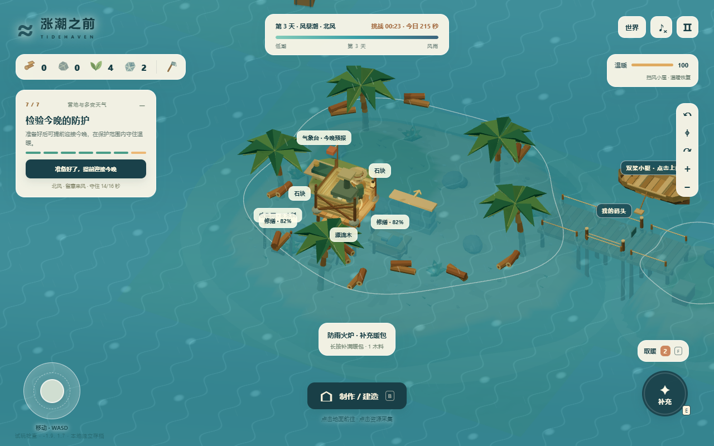
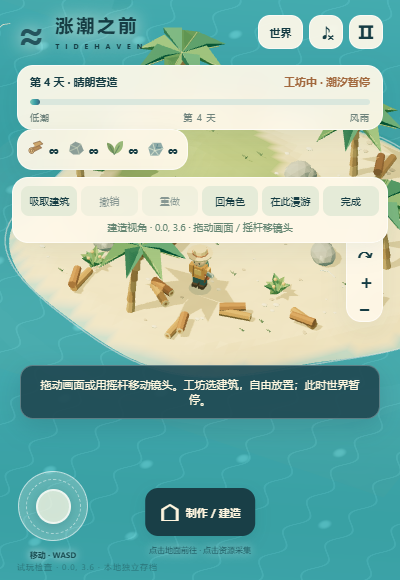

# 本地验收基准 · v4.0.0

日期：2026-11-05。源码上传前重新运行 39 项规则测试，全部通过。保留采集、建造、真实支撑/碰撞、风雨失温、暖包、小艇、新岛、存档迁移、生产和修缮规则；新增独立世界、原营地隔离、建造历史、批量操作、玩法切换与安全漫游。

桌面实际 Chrome 1280×800：原 v3 第四天 16 个建筑及背包保留；创建命名自由世界、3×3 建造、按钮和键盘撤销/重做、吸取单格、远处建造、命名配色、连续 12 次进入下一天至第 16 天、复制、下载真实 JSON 文件再导入、切回原营地、回到自建世界并刷新、庭院布置、重建当前世界而其他世界不变。

手机模拟视口 400×580、390×780：实际触摸创建空白/营地世界、建造与撤销/重做、庭院选择、摇杆移镜头且角色位置不变、释放停止、在此漫游、改名和刷新；按钮在屏内，没有整体页面溢出。

新建生存营地实际验证：起始 36 木料且有限材料，未完成挑战时不能跳天；切到自由建造，再在编辑期间切回生存，安全退出编辑并保留真实库存。

v4 原流程回归：第一天采集建造、礁岛、加固、迎潮和进入第二天；第二天海上刷新、沉船打捞、甲板步行、返船、返航、工作台与暖包、交接第三天并刷新；第三天预报、抬高原屋、迎风石堤、升级火炉、守住 16 秒；第四天生产收取、材料开关与恢复。

上述实际路径未捕获浏览器脚本错误。规则层另外验证 520 格连接地板及恢复、1000 次后续跨天；这些是规则压力测试，不声称玩家实际点击建造 520 次或进行了无限挂机。

## 边界

以上为本地基准，不代表 Loopit 宿主已验收。平台首稿需另测加载、输入、世界创建、批量建造/撤销、手机尺寸和刷新。未覆盖真实手机 GPU、极大量建筑长时性能、联机、云存档、音乐审听和 Powers。上传排除本机浏览器档案、私人存档、缓存、原始日志和旧版 ZIP。
