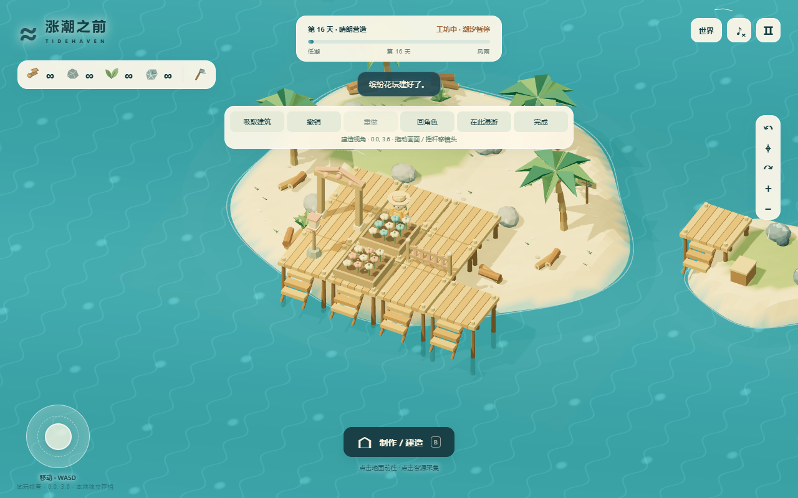

# 涨潮之前 · 我的世界

真实 3D 生存与自由建造沙盒，版本 4.0.0，2026-11-05。包含已试玩的前三天成长、持续跨天和独立世界营造。GitHub 保存源码基准，Loopit 首稿需另行接入与试玩验证。

中文路径：`games/生存沙盒/涨潮之前/`。版本使用 Git 提交追踪，不另建一堆版本目录。游戏专区所在分支为 `codex/krabby-patty-flip`；个人学术主页的 main 分支独立保留。

## Loopit 初稿

[试玩 V1](https://cdn-cf.loopit.me/public/game/01a1a7c2-3d75-75f9-b378-4f04a3273a6b/2118175540358696960/workspace/dist/index.html?loopit_preview=draft) · [创作草稿](https://lab.loopit.me/pgc/workbench/01a1a7c2-3d75-75f9-b378-4f04a3273a6b?kind=draft) · [平台验收记录](./LOOPIT_QA.md)。2026-11-05，基于固定源码提交 `bda692a06b47ed54aa3807fb4ab6783d14bb262c` 接入，采集、建造、独立世界、批量铺地、撤销重做、跨天和刷新恢复已实测；尚未发布展厅。平台域名的存档与本机隔离，继续本机营地可导出世界 JSON 再导入。

## 玩什么

- 第一天：采集、地板、小屋、营火、石斧、跨海栈桥、礁岛和加固，守住第一场风雨。
- 第二天：原营地继续，升级码头、造小艇、近海沉船打捞、工作台和便携暖包。
- 第三天：气象台、预报、抬高原屋地基、按风向布置石堤/挡风墙、防雨火炉，检验营地防护。
- 之后：不同长度和天气的新一天，生产、修缮、新岛探索，持续扩建和重玩，没有通关终点。
- 我的世界：另建命名世界，选择生存或自由玩法；空白小岛或营地起步。原营地单独保留，可复制世界、导出 JSON、导入为独立世界。
- 自由建造：镜头远距离移动，单格或 3×3 铺设、吸取同款、连续放置、30 笔撤销/重做、在镜头处漫游。拱门、栅栏、花坛、庭院灯和配色可以组成自己的小镇。

## 运行

入口 `index.html`，无需安装依赖或构建，全部 Three.js 代码和许可在 `vendor/`。场景、人物、建筑、海面与音效由代码生成，没有外部 CDN 素材。

在本目录运行 `python serve.py`，打开 http://127.0.0.1:8774/ 。Windows 也可双击 `START_GAME.cmd`。请通过 HTTP 服务运行，不直接双击 HTML。

点击地面行走、点击资源走近采集；WASD/摇杆移动，长按 E/动作按钮交互。B 打开工坊，点地面选址，R 旋转，空格确认，Esc 返回。第二天可上船划行，F 使用暖包。

右上角「世界」创建、切换、复制和备份世界；「建造视角」拖动/WASD/摇杆移镜头，撤销/重做支持 Ctrl+Z/Ctrl+Y。自由世界可「在此漫游」，走进远处刚建好的区域。

## 验证与交接

运行 `node --test tests/*.test.mjs`：39 项测试。具体实测范围见 [本地验收](./QA.md)，平台适配必须保留的规则见 [Loopit 接入说明](./LOOPIT_HANDOFF.md)，逐文件哈希见 [源码清单](./源码清单.json)。截图均为真实本地试玩画面，平台首稿需另行验证。

正常存档镜像键 `tidehaven-camp-v1`，世界索引 `tidehaven-camp-v1-worlds-v4`，各世界独立存储。兼容旧 schema 1/2/3/4。存档按浏览器与站点隔离；换到 Loopit 域名后，可通过世界 JSON 导入继续，不会自动读取本机另一个站点的存档。

本次仅授权 GitHub 备份与 Loopit 草稿，没有授权展厅发布。建筑与天数不设关卡数量上限，实际规模受设备、存储配额和数值精度限制。没有联机、云存档、任意地形雕刻或多楼层堆叠；当前 JSON 导入限制 8 MB。
