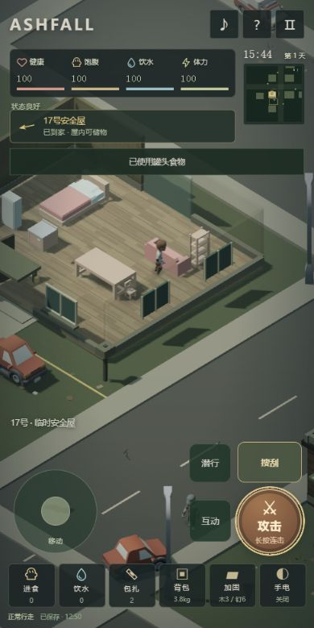
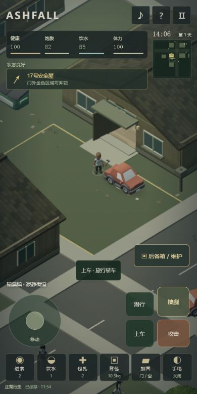

# 灰烬街区 · ASHFALL

手机竖屏优先的真实等距3D末日生存街区，已认可本地基准v0.7.0。2026-11-05授权上传GitHub并接入Loopit初版草稿，尚未发布展厅。中文资料路径：games/生存沙盒/灰烬街区/。

[试玩Loopit V1](https://cdn-cf.loopit.me/public/game/01a1aa1d-201a-78c4-8085-bdc5acd7f103/2118209181587640320/workspace/dist/index.html?loopit_preview=draft) · [创作草稿](https://lab.loopit.me/pgc/workbench/01a1aa1d-201a-78c4-8085-bdc5acd7f103?kind=draft) · [平台验收](./PLATFORM_QA.md)。平台版本2118209181587640320；源码基准cc2d6c3c700ee1460af161de82ef5a204038dbfd，手机关键操作已实测，未送审。

## 玩法

从17号安全屋出发，搜刮食物、饮水和建材，装入车辆后备箱运回真实储物箱；驾驶消耗燃油，碰撞损伤车况，支持加油和维修。感染者根据声音和视线追击、破板破门。用2木板2钉子封堵，或4木板4钉子重建被攻破的门。

左拇指摇杆移动，右拇指轻点攻击一次、长按连续挥击，自动朝向最近无遮挡近敌。挥击时可以后退，独立指针处理松开和取消。近敌亮圈、命中反馈、体力与恢复环。独立搜刮入口、固定面板按钮、健康/饱腹/饮水/体力图标与文字。

地图边长118世界单位（按游戏界面米制），8栋可进入建筑、5辆车、29处搜刮容器。昼夜持续推进、有限物资和感染者、不自动生成新街区。当前没有雨水收集、种植或无限地图。

## 运行与依赖

无需npm构建或安装依赖。入口index.html；本目录运行 python serve.py 或 python -m http.server 8786 --bind 127.0.0.1，再打开浏览器。Windows可双击开始试玩.cmd。必须通过HTTP而非file协议运行。

Three.js 0.186.0随vendor提供，包含核心、GLTFLoader、SkeletonUtils、BufferGeometryUtils及其依赖。58个实际加载GLB（含4个带Idle/Walk/Run的蒙皮角色）、PNG纹理、7段OGG及许可证均在assets中，不依赖本机路径或外部CDN。素材来源见assets/manifest.json与assets/licenses/；环境模型为Kenney CC0，角色GLB由其原FBX整合和重定向烘焙。程序街区、材质、规则、AI、界面为本地实现。

## 验收与边界

上传前 node --test tests/*.test.mjs：74项通过。实际本地搜刮、驾驶、货运、破门重建、刷新恢复、手机攻击与360/390布局记录见QA.md。素材与源码哈希见SOURCE_MANIFEST.json；平台接入要求见LOOPIT_HANDOFF.md。

存档格式v4，兼容旧版1/2/3；普通键ashfall-world-v1，qa=1使用独立测试键ashfall-qa-world-v1。存档按域名/端口/浏览器隔离，平台不会自动读取localhost进度。不要传输用户真实存档。

仅授权GitHub备份和Loopit草稿。实体手机多指手感、低端机性能、长时生存、音频审听和Powers尚未完成平台验收。无联机、完整感染系统、种植、自由整屋搭建或无限地图。
