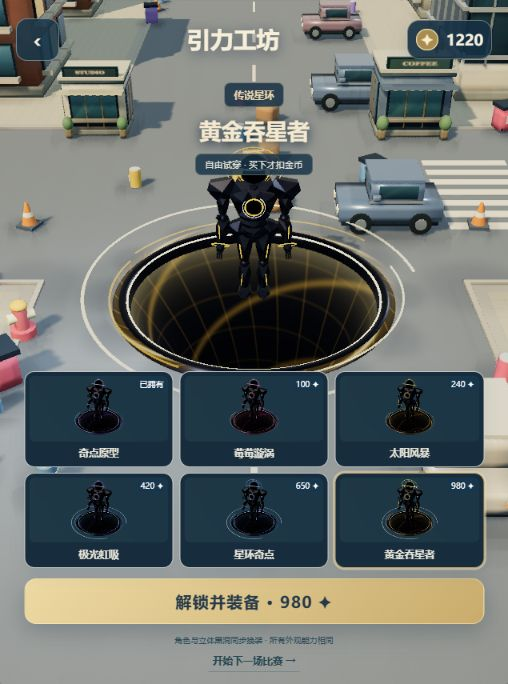

# 黑洞都市 · 自由吞噬

用户认可的本地版本 **v0.7.0**。真实Three.js三维城市、360°自由移动、黑洞吞噬成长与电脑竞技；保留已确认的黑色人形“奇点行者”。



## 运行

下载本目录的全部文件后，双击 `启动试玩.cmd`，或在本目录执行：

```sh
python serve.py --open
```

默认端口8793，当前游戏入口为 `index.html`（与 `arena.html`相同）。也可以用任意静态HTTP服务打开本目录。不要直接用file协议打开HTML；ES模块需要HTTP。运行无须npm安装，依赖Three.js已在vendor内附带。

- 手机：拖动画面控制方向、松手停止；点地面或小地图也可设定目的地。
- 电脑：WASD或方向键；Esc暂停。
- 本地金币与已购外观保存在同一浏览器、同一来源的localStorage，切换域名不会自动迁移。

## 当前玩法

- 每场120秒，1名玩家与5名本地电脑。没有真实网络联机。
- 从饮料罐、垃圾桶成长到汽车、商铺和高楼；吞不下的建筑需要绕行。
- 半径比对手大25%且覆盖对方时可以吞噬；最初12秒为保护期。绿圈表示可吞、红圈表示危险、白圈表示保护。
- 电脑会追逐、避让和搜集；被吞后5秒在安全街口返场，带4秒保护，体积降低、已获得积分保留。玩家被吞则结束本局。
- 远处物件按小物、车辆、建筑的不同间隔逐步补充，避开角色周围。
- 未被吞的前三名奖金200/140/100，第四名及以后、提前被吞均为0；一局只结算一次。
- 六款外观可以试穿、购买和装备，外观不改变能力。结算后可以直接换装或重开。

洞口由实际向下收缩的曲面、深色喉部、细光子环、吸积流和向下光尘组成；车辆与建筑旋转收拢后下沉。模型、材质和场景由本项目代码生成，未复制Hole.io的图片、模型或代码。

## 文件

- `src/arena-rules.mjs`：移动、碰撞、成长、追猎、返场、资源恢复和奖金。
- `src/arena-scene.mjs` / `src/void-portal.mjs`：城市渲染、真实立体洞口、吞噬动画与工坊。
- `src/city-art.mjs` / `src/city-post.mjs`：分材质建筑、车辆、植被、接触与深度遮蔽。
- `src/mascot.mjs`：用户已确认的奇点行者。
- `src/arena-app.mjs` / `src/arena.css`：触控、界面、音效、换装和存档。
- `tests/`：32项规则测试，执行 `npm test` 或 `node --test tests/*.test.mjs`。
- [QA.md](./QA.md)：验收证据与范围。
- [LOOPIT_HANDOFF.md](./LOOPIT_HANDOFF.md)：后续平台接入说明；本次仅GitHub源码交付。

历史跑酷版保留为 `parkour.html`，可双击 `启动跑酷旧版.cmd`；当前默认入口始终是自由吞噬版本。为中文目录独立打包时，仅调整默认HTML入口、旧版相对链接和启动脚本，竞技规则与原人物模型保持本地验收版。

Three.js许可证见 [vendor/LICENSE](./vendor/LICENSE)。音效由Web Audio合成；正式音乐和Loopit Power尚未接入。
