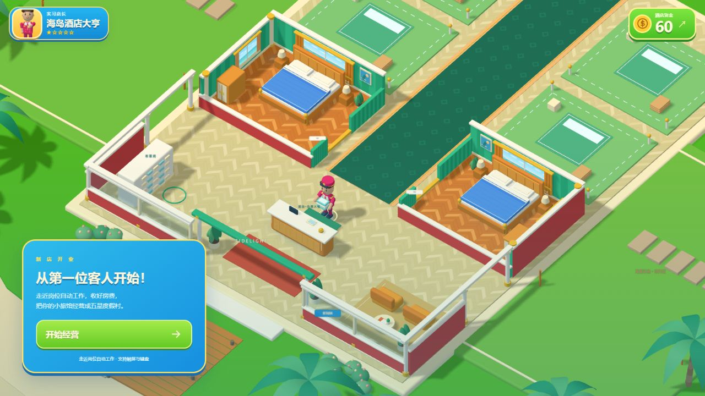

# 海岛酒店大亨 · Loopit V1 交付记录

2026-11-11，用户授权上传并同步初稿。当前 **V1 已生成，基础经营与手机布局已实际试玩；草稿未发布、未送审**。

- [Loopit 创作草稿](https://lab.loopit.me/pgc/workbench/01a1ca63-2b21-79d2-855e-7b527896066a?kind=draft)
- [V1 独立试玩](https://cdn-cf.loopit.me/public/game/01a1ca63-2b21-79d2-855e-7b527896066a/2120486784327507968/workspace/dist/index.html?loopit_preview=draft)
- 可维护源码基线：`d78187cc4fd19c76eb0dbc60c7b99c9f347299c2`，v0.5.0。
- 同款单文件兼容入口：`267de323d519c517c09ba477d89c38e4dfd2a17c`；说明见 PLATFORM_BUNDLE.md。原20个模块、配色和游戏规则保留。
- 平台产物：V1，任务/产物 `2120486784327507968`，界面显示“当前产物 已完成”“版本1/1 已完成”。

## 实际试玩

Chrome 创作者宿主 iframe 约472.6×757.6：从60资金开始，真实办理两次入住，退房后出现两笔46房费；收第一笔46与60目标后206，清洁101消耗毛巾至2/4，目标1/2。刷新创作页后206资金、房间状态和毛巾保留；清洁后回前台继续营业。

独立内置浏览器采用 `qa=loopit-v1-review` 隔离测试存档：320×580，页面宽度320，无横向溢出；摇杆左侧实际按住650ms，由 x0.00/z8.02 到 x-3.25/z9.82，屏幕方向正确。导航收第一笔后206，清洁1间后2/4毛巾；购买150步速后56，Lv.1/5、步速125%；刷新后资金、已购等级与清洁进度保留。客房/雇员/设施/店长/成长五类面板可用，成长页保留头衔、别墅前置、循环订单、研修和四套制服。

平台 `showroom=estate&qa=loopit-v1-art` 是明确标记“非经营进度 · 不写入存档”的美术样板，只用于确认四栋不同级别别墅、原配色、人物与跨桥入住内容存在，不作为正常赚取资金或解锁节奏的证据。

作品标题已在工作台保存为“海岛酒店大亨 · TIDELIGHT HOTEL”。最终无QA/样板参数的试玩页从正常60资金开业，留给用户体验。本机原存档和原服务器不重置。

## 平台交付过程与边界

前两次任务 `2120480234695294976`、`2120483855247892480` 未产出页面，后者返回“源码无法匹配已检查版本”。之后采用已本地验证的合并入口，并要求对最终文件按正式流程重新构建、检查、交付。第三次任务出现真实V1产物并通过上述浏览器检查。平台文字回复仍保留版本关联疑虑，本记录以完成标记、可打开URL和实际操作为验收证据，不声称已修复平台内部记录机制。

平台源码没有导出作逐文件哈希比对；请求指定上述固定提交，实际画面、规则数值和成长内容与本地基线对照。34项自动测试和构建通过属于GitHub源码，本次平台检查是以上真实浏览器操作，二者分别记录。

运行日志可见宿主身份初始化、WebSocket/Colyseus包装与重复Three.js实例警告；Chrome另有视频嗅探扩展的跨域错误。当前实测基础经营与本地保存正常；没有据此声称平台身份/云存档、联机或真机硬件性能已通过。此单人游戏沿用本机localStorage，不依赖这些平台联网能力。

