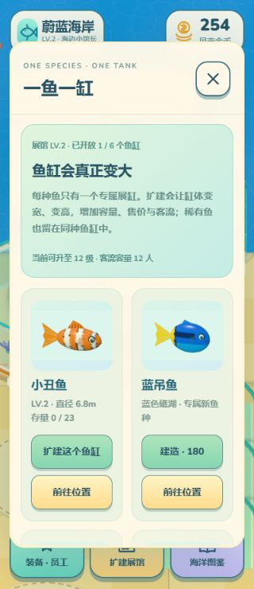

# Loopit V1 平台验收 — 海洋馆大亨 · 蔚蓝海岸

2026-11-13；用户授权的中文初稿，未送审、未发布大厅，可继续修改。

- 固定源码 commit：9e3b492398a98f7426b24640a74442ab0cb18b8f（v0.4.0，46个文件逐个远端SHA核对）。
- [编辑初稿](https://lab.loopit.me/pgc/workbench/01a1d1a2-a456-73d2-b8b5-1483d762cf6b?kind=draft)
- [独立试玩](https://cdn-cf.loopit.me/public/game/01a1d1a2-a456-73d2-b8b5-1483d762cf6b/2120990263559077888/workspace/dist/index.html?loopit_preview=draft)
- 平台版本：V1 / 2120990263559077888。

## 实际核验

1. 编辑器预览和独立试玩均显示同一真实3D海洋馆，原潜水员、鱼群、财富陈列、透明通道与中文菜单保留。
2. 独立平台初始120金币、小丑鱼库存3，实际卖完变为186。
3. 点击下海捕鱼，沿码头导航至珊瑚浅湾，捕获10条（其中1条稀有），背包显示10/10。
4. 氧气耗尽带完整货物安全返岸；点击回馆补货，库存逐条投放和真实售卖后背包0，现金384；日耀稀有小丑鱼永久留展。
5. 一鱼一缸面板仅1/6种已开放。原缸升级花130，现金384→254，容量16→23，Lv.1→Lv.2，直径6.20→6.83m、缸高3.95→4.35m；未增加第二座同种鱼缸。
6. 刷新/重新打开平台预览后现金254、0/23、Lv.2与稀有留展恢复。
7. 390×844与320×740实际浏览器尺寸下试玩；后者canvas与body均320×740，document无横向溢出，经营菜单及扩建卡片按钮可操作。
8. 平台项目显示名整理为「海洋馆大亨 · 蔚蓝海岸」，状态已完成/未送审。

本地规则检查53/53与合并交付包闭环另见QA.md。这里仅记录实际测到的代表性平台闭环；高等级长期成长、全部雇员/装备组合和旧存档迁移已有本地测试，本次未在平台重走全部长期内容。独立匿名试玩曾记录Loopit运行时身份bootstrap网络警告，未阻塞上述核心操作或本地存档恢复；未声称平台账号云存档已验收。
