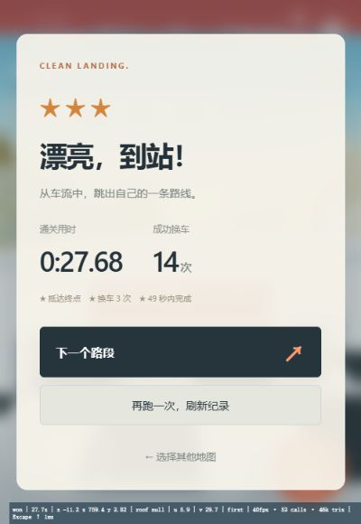
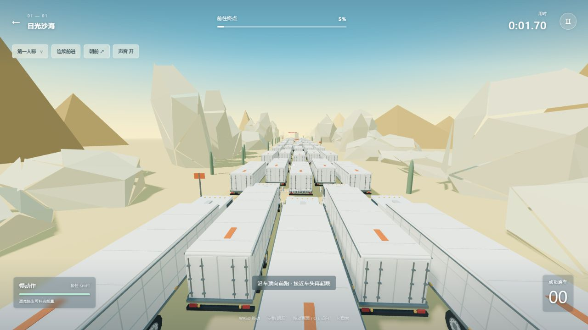

# 本地验收记录

**当前版本 v0.4.2：** 39 项检查通过。下蹲作用对照、普通路段隐藏、接近限高架显示及通过后收起见 [v0.4.2 报告](qa/v0.4.2/REPORT.md)。

**v0.4.1：** 37 项检查通过，重新制作跳跃姿势，实际起跳/落地/再次起跳和动作各阶段检查见 [v0.4.1 报告](qa/v0.4.1/REPORT.md)。

**v0.4.0：** 35 项检查通过；屏幕常驻跳跃、竖/横屏/平板实际按钮操作、新角色与装备验收见 [v0.4 本轮报告](qa/v0.4/REPORT.md)。

**v0.3.0：** 28 项检查通过；首屏三地图、三段通关说明、开局/失败重试/返回/刷新与手机排版见 [v0.3 报告](qa/v0.3/REPORT.md)。结算样本单独标识，不当作三段实际通关证据。

**v0.2.0：** 21 项检查通过，沙海首段实际浏览器通关 26.82 秒 / 15 次换车 / 三星；手机视口、动作、画质切换和控制台检查见 [v0.2 报告](qa/v0.2/REPORT.md)。下文保留 v0.1 的历史基线。

## v0.1.0 本地验收 · 2026-11-10

本地入口 http://127.0.0.1:8798/ 。游戏保留在浏览器主菜单，未同步 GitHub 或 Loopit。测试使用 `?qa=1` 独立存档，正式试玩无测试星级。

## 实际浏览器通关

- 环境：Codex 内置 Chromium 浏览器，400×580 竖屏覆盖布局，使用真实键盘输入操作；关卡「日光沙海 / 路段 1」。
- 从新局出发，W 助跑，W+A+空格跨到左侧车辆，再连续向前助跑和跳跃，途中两次 A 修正落点。每段操作之间暂停，以便读取可见状态；计时只包含游戏推进时间。没有修改角色坐标、支撑车辆、胜利标记或分数。
- 实际终点结算：**27.68 秒、14 次成功换车、三星**。最终可见状态 `won`，位置 s=759.4、y=3.82，落在真实静态终点平台，支撑不再是车辆。实际结算画面和可访问性文本保存在 `qa/first-clear.png`、`qa/first-clear.ax.txt`。
- 点击「下一个路段」实际进入 01—02，计时、换车数、进度归零。返回菜单、刷新后，路段 1 的三星仍在。普通入口单独打开，确认没有复制 QA 成绩。

## 实际浏览器检查

- 1280×720 桌面、400×680 及 400×580 竖屏：主菜单的地图、路段和开始按钮可见；HUD、摇杆、下蹲、慢动作和起跳按钮不重叠，结束页可立即重试。
- 第一人称和第三人称真实切换，蒙皮人物加载正常，脚下支撑随车辆移动；实际按住 W 909ms 产生前进位移，按 A 跨到左侧车辆。输入兼容缺少 `KeyboardEvent.code` 的合成事件。
- 触屏起跳按钮实际让角色从 3.82m 的车顶升到空中；空中预测四角提示、起跳/落地反馈与换车计数对应实际支撑变化。
- 连续前进但不跳，实际落地失败；400×580 的失败原因和「马上重来」可见。点击后计时与进度归零、慢动作满能量，可以再次起跳。
- 暂停冻结计时和车流，继续后恢复。手动暂停后查看帮助，不会因关闭帮助而擅自取消原暂停。
- 峡谷地图首个路段、冰原第三路段均实际进入。曾发现峡谷预览镜头进入岩壁，已把菜单镜头移入道路走廊后重新截图检查。桥体沿实际弯曲道路生成，终点平台有桥墩支撑。
- 400×580 的能量条与道路提示曾重叠，修正后重新检查。移动端能量提示改为「按住右侧按钮」。
- 正式入口最终控制台没有应用错误；Three.js 曾报告旧软阴影枚举回退到 PCF。源代码最后改为直接使用同一个 `PCFShadowMap`，与已实测的实际回退渲染行为相同。

## 自动规则验证

`npm test`：**12 项通过**。覆盖镜头相对左右、弯道支撑携带、旋转车顶范围及驾驶室高度、起跳继承速度、短按/长按、离边宽限、空中不重复跳、暂停冻结、慢动作现实时间消耗、失败与确定性重试、九种配置结构，以及普通操作序列连续跨车并抵达真实终点。

自动控制序列与上面的真实浏览器通关分开记录。`tests/route-probe.mjs` 是研发路线探测器，有限策略在部分障碍前会停住或失败；它不是关卡通关率，也不包含在 `npm test` 的验收断言中。

## 本次范围与尚未完成的验证

- 本次实际完成了首个沙海路段通关、另外两张地图进入/画面检查及状态流程。没有声称其他八个路段已人工通关。
- 真实手机设备、多点触控长局、音频听感和不同 GPU 的性能未做设备实测。短时浏览器采样出现过 30–53fps；窗口后台降帧时更低，不将这些混合样本作为稳定帧率承诺。
- 卡车使用弯道跟随、车距制动、接触修正和受击倾覆等自编街机物理。没有商用原作那样完整的关节刚体、车体破坏或大规模连锁物理。
- 难度与新手首次体验仍应根据用户试玩调整。三张地图/九路段是当前有限配置，不是无尽程序生成。
