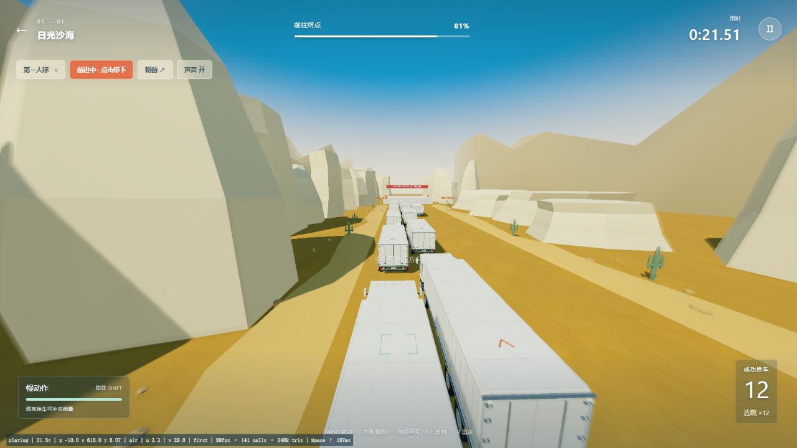
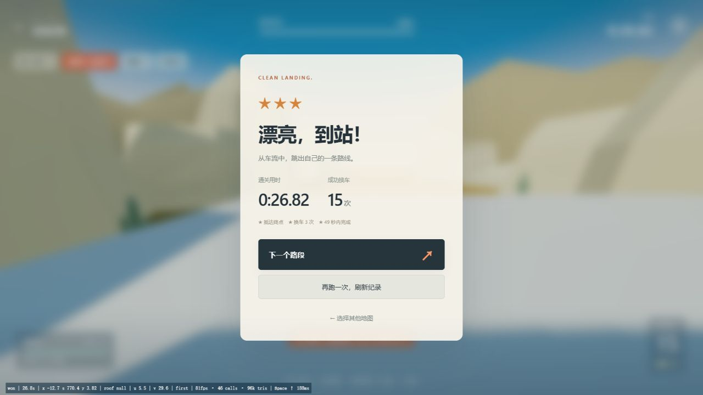

# v0.2.0 · 本地质感与动效验收

日期：2026-11-10。授权范围：本地细化车辆、场景和跳跃/落地动效。没有上传或同步外部平台。入口 http://127.0.0.1:8798/?v=0.2.0 。

## 参考与实施

重新观察了 [Clustertruck 官方商店预告](https://store.steampowered.com/app/397950/Clustertruck/) 中的白色长车厢、蓝色玻璃、暖色地面/冷色天光、巨大几何岩壁、桥塔框架、宽视野与腾空/运动模糊。仍未操作商业原作，未使用其模型、材质、音频或品牌图形。

- 车辆：驾驶室改为带斜面的轮廓与风挡，车厢有门锁、铰链、分层车架和密封边；八轮底盘、近景胎纹、轮毂螺栓、金属和玻璃材质；轮胎接地点与路面对应。远轮胎降级为简化模型，阴影使用车体代理，减少细小零件的阴影杂点。
- 环境：由重复多面石块改为不同轮廓的岩柱/层岩和远山，道路增加肩坡、碎石、浅轮迹；峡谷桥架有桥墩、横梁、桁架和落到桥面的拉索锚点，雪林分层制作。
- 表现：解析弹簧控制垂直镜头、转向倾斜和冲击恢复；视野和外围拖影随实际速度变化，中心落点保持清晰，慢动作减弱拖影；固定步长的玩家/车辆位置在渲染时插值。所有这些都不写回角色物理位置或修改胜负。
- 动画：发现模型和完整重定向动作存在同名的 `run/jump/land` 等动画，旧查找顺序会先取简化版。已改为正式动作覆盖同名动作，按腾空阶段采样，落地片段在实际接触时重新触发，并与奔跑混合。第三人称朝移动方向平滑转身。
- 音效：风声随速度与腾空变化，落地按实际下降速度触发低频/金属声；重开清理旧结算音效回调。

## 实际浏览器结果

- `?qa=v02-review` 独立存档，从沙海首段开始，通过普通键盘与页面按钮完成 15 次换车并跳上静态终点平台。实际结果：**26.82 秒、三星**；终态 `won`，s=770.4、y=3.82、支撑为 `null`。
- 操作中在落车后暂停观察可见读数，再继续；没有更改位置、车速、碰撞、积分或结束标记。中间有一次过晚起跳失败，正常显示失败并重试；失败和重开均检查。
- `clear.png` 与 `clear.ax.txt` 保存实际通关结果。`speed-flight.png` 为真实腾空截图，薄荷色落点标记跟随预测车顶。完整流程在第三人称动画选择修正前完成；之后又独立复测了修正后的触屏起跳与落地，物理参数和第一人称流程没有变化。
- 三张地图的菜单/场景加载均检查；峡谷和冰原画面分别保存在 `canyon-showcase.png`、`alpine-showcase.png`。其他八个路段没有宣称完成人工通关。
- `mobile.html` 内用真实 400×580 iframe 运行游戏，具有单独的 `qa=v02-mobile` 存档，不需要改变用户浏览器窗口。实际点击触屏起跳，切换第三人称，角色升到约 7.9m 后重新落到原车顶约 3.83m，原地跳保持换车数 0；新版正式动作截图为 `mobile-third-person-authored.png`。
- 400×580 的开始、暂停、返回、起跳与画质切换均可点击。高清 → 流畅 → 高清后仍正常渲染；没有黑屏或失效的深度附件。
- 正式入口 `?v=0.2.0` 仍显示原有沙海首段三星和路段 2 选择，未写入独立回归成绩。旧普通存档键保持 `convoy-leap-v1`。
- 最终正式入口、独立回归页及手机 iframe 的 error/warn 日志均为空，见 `browser-diagnostics.json`。

## 代码检查

`npm test`：**21 / 21 通过**。除原有 12 项物理/状态检查外，覆盖动画同名优先级、30/60/144fps 下弹簧一致性、落地冲击与恢复、暂停/重开不残留镜头扰动、速度视野/拖影、细化车模与落地高度对齐、轮胎细节降级及真实落地冲击元数据。

新增后处理为一个屏幕通道；无浮点色缓冲扩展时使用普通颜色目标。高清使用设备支持的多重采样和接触明暗，流畅关闭额外采样。仅记录过实际短时帧率，不将窗口前后台、不同尺寸和多个标签混合的数值当作稳定性能承诺。

真实手机 GPU、多点触控和音频听感仍未做设备实测。自编车辆街机物理及有限地图规模未扩展为原作的完整刚体破坏系统。
